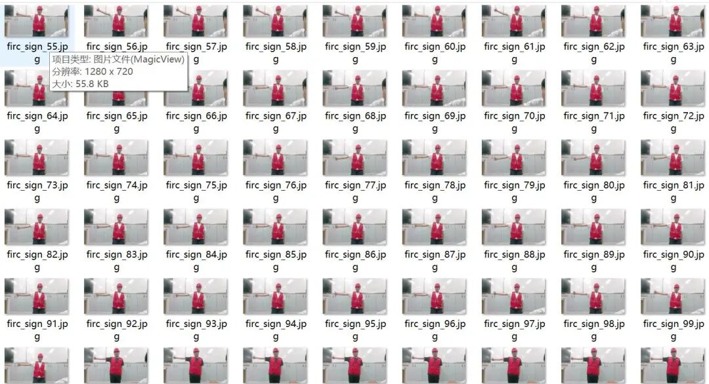
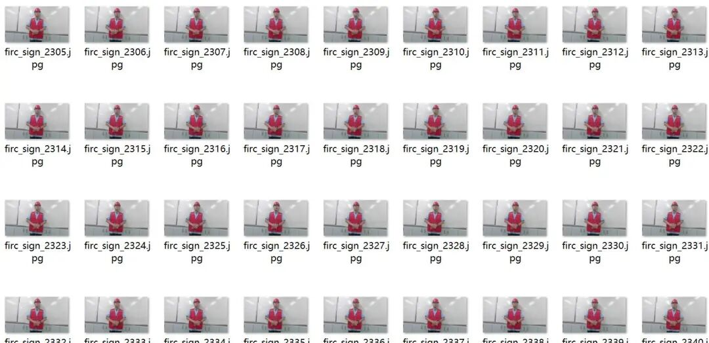
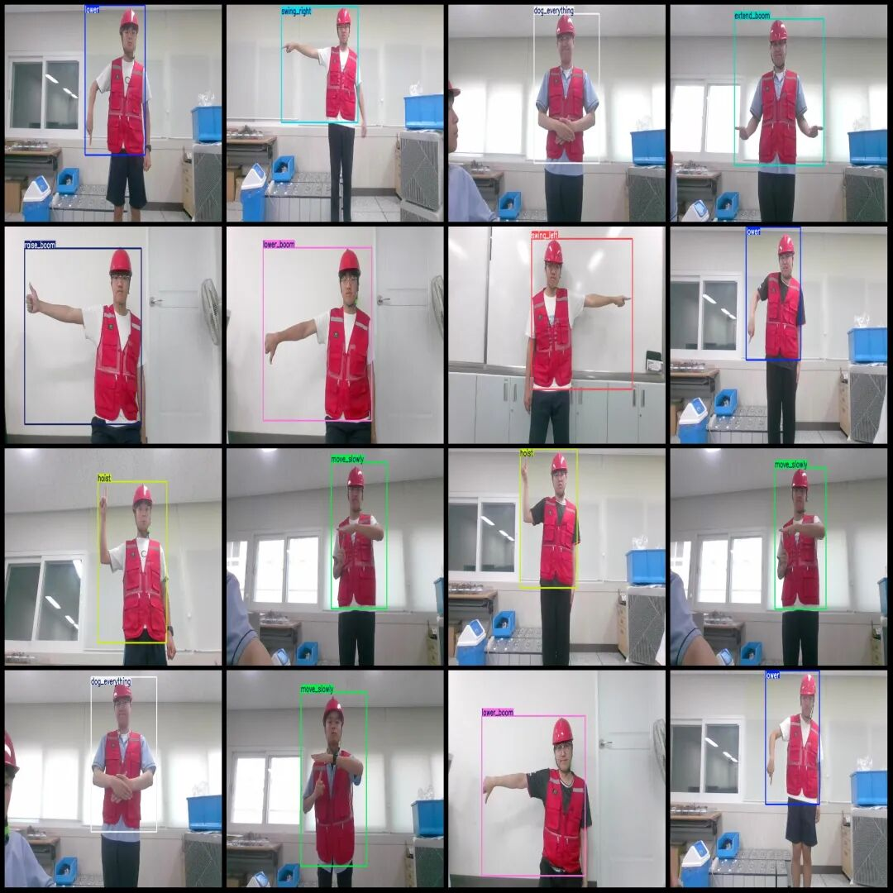
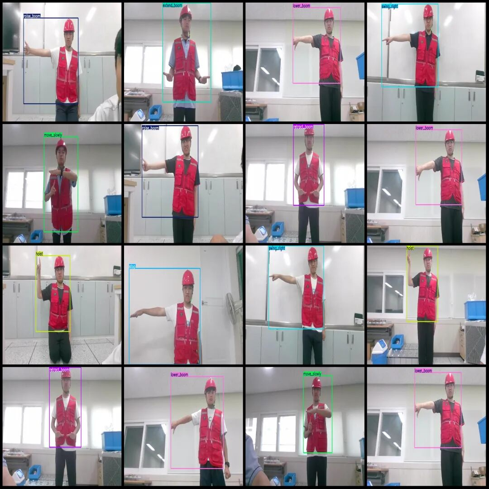

# Crane Gesture Recognition Signal Manual Detection Dataset VOC+YOLO format with 3364 images in 11 categories

Note: The dataset is composed of images formed by recording videos with different gestures and then extracting frames from the videos.

Dataset format: Pascal VOC format + YOLO format (txt file without split path, only containing jpg images and corresponding VOC format xml files and yolo format txt files)

Number of images (number of jpg files): 3364

Number of annotations (number of xml files): 3364

Number of annotations (number of txt files): 3364

Labeling category count: 11

Label category names (Note that the order of categories in the YOLO format does not correspond to this, but is based on the labels folder's classes.txt): ["dog_everything", "extend_boom", "hoist", "lower", "lower_boom", "move_slowly", "raise_boom", "retract_boom", "stop", "swing_left", "swing_right"]

Number of boxes labeled in each category:

dog_everything (all-round action) box count = 286

extend_boom (stretch boom) frame count = 287

Hoist (lift) Frames = 298

Lower (down) frame count = 320

Lower boom (declining boom) frame count = 300

Move_slowly (Slow Motion) Frames = 300

Raise boom (jacking arm) frame count = 349

retract_boom (retracting boom) frame count = 296

Stop (stop) frame count = 320

swing_left (left turn) frame number = 299

swing_right (right turn) frame number = 310

Total frame count: 3365

Number of images per category:

dog_everything (All-in-One Action) occupies 286 images.

extend_boom (stretch boom) occupies = 286

Hoist (lift) occupancy = 298

Lower (decrease) occupancy count = 320

Lower boom (declining boom) occupies a picture count = 300

move_slowly (slow moving) occupies = 300

Raise boom (jacking arm) occupies 349 images.

retract_boom (retreat boom) occupies = 296

Stop (stop) occupancy count = 320

swing_left (left turn) occupies = 299

swing_right (Right Swing) occupies a picture count = 310

Image resolution: 1280x720

Using labelImg:

Annotation rules: Draw a rectangle around the category.

Important Notice: The dataset does not have separate training, validation, and test sets; you need to partition them yourself.

Special : This dataset does not guarantee the accuracy of the trained models or weight files.

Image Preview:

Annotation example:

## Payment

Here is a pay link on Stripe ( https://buy.stripe.com/3cs8yP7sY87d0vu9AB ). Please contact me lonlonago@foxmail.com after funding $89, and I will send you a complete data files , thank you!

